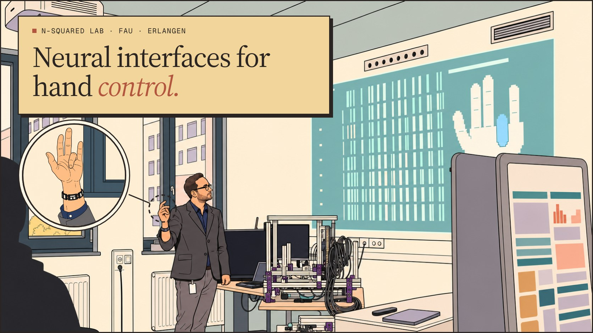
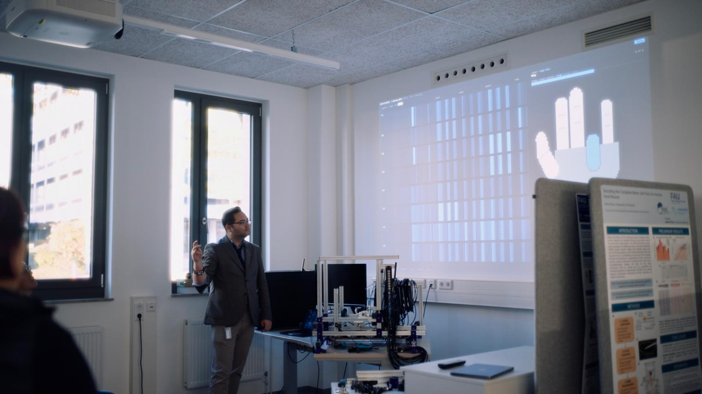
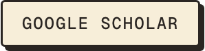
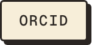
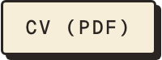
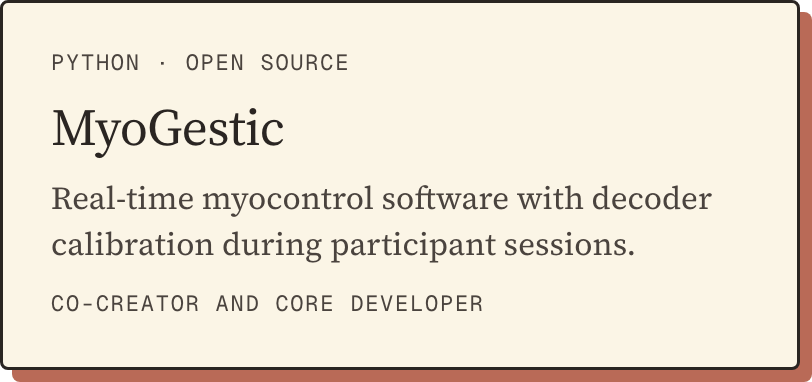
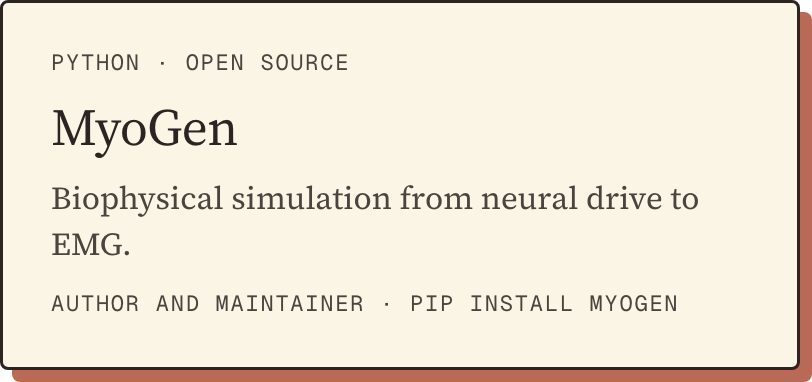

<a href="https://raulsimpetru.github.io/"></a>

<details>
<summary><b>How this drawing was made</b></summary>
<br>


Redrawn from this photo with **OpenAI Codex (gpt-6-astra)** and its built-in image_gen tool, using two of my website's illustrations as style references: a full redraw, then one correction. The hand close-up was drawn the same way from a crop of the photo.

**Prompt · redraw**

```text
Use case: style-transfer with identity and composition preservation.
Make ONE finished image, lab-screen, widest landscape available, exact 16:9 aspect ratio.
Inputs: raul_1.jpeg is the edit target and absolute composition/identity reference. style-1.png and style-2.png are art-style references only.
Completely redraw the laboratory photograph as a clean-line European science-fiction comic illustration in the Moebius / Sable visual style shown in the two references. Thin uniform black ink contours, sophisticated flat cel colour, utterly clean smooth fills, no texture or grain, no hatching, no photographic shading, no 3D rendering. Pastel sand, cream, ochre, terracotta, dusty teal, sage and lavender, with charcoal clothing.

Keep the original photograph's exact perspective, camera angle, cropping, relative object positions and scale, and 16:9 framing. Do not zoom in or rearrange the composition. A man stands left of centre in the lower part of frame, roughly x=27%-39%, beside a lab demo rig. Keep him recognisable from the photo: short dark-brown hair, rectangular dark glasses, short dark beard, same slim build; right hand raised in the exact explanatory gesture, left arm down, head and gaze angled up/right toward the projection. Same charcoal grey blazer, dark navy shirt, grey trousers, white blank badge on dark lanyard, dark wristband. Preserve the distinctive face in flat drawn form.
Two tall dark-framed windows at left, showing simplified pale buildings as in the photo. Ceiling-mounted projector partly cropped at upper left. A dark monitor beside the presenter, aluminium-frame recording rig with purple brackets and looping black cables on the desk at lower centre, matching the photograph's size and placement. Grey poster board in the right foreground, cropped as in photo, with only abstract unreadable colour blocks for its content. Left foreground audience member is a single simple dark silhouette from behind with no face; preserve their original crop and scale. The lower-right equipment/table edge stays where it was.

The large upper-right wall projection shows a grid of motor-unit spike raster vertical bars, pale teal and cream, and a white blocky pixel hand with one finger highlighted blue, matching the source's placement and overall appearance. Make the projection feel softly luminous through pale flat colours and at most a very subtle soft border; no text anywhere in it.
Negative space for future website overlay: the wall between the right window and projection, ceiling and upper wall must stay plain, flat, calm and nearly empty. Simplify ceiling into a few broad planar shapes with no speckle, tile texture, busy lines or added vents. Maintain clear light areas.
Absolutely NO lettering, numbers, glyphs, logos, signatures or watermark anywhere, including projection, badge, equipment and poster. No desert exterior in this first version. Render the entire image as original flat ink-and-colour illustration, not as a filter on the photograph.
```

**Prompt · correction**

```text
Edit this illustration with only the following focused corrections. Preserve the laboratory, composition, all object positions and scale, presenter identity and pose, all clothing, the raster and pixel-hand projection, and the wide 16:9 framing exactly.
1. Replace the entire left foreground audience person with ONE uniform flat dark charcoal silhouette, seen from behind, with absolutely no face, no visible facial profile, no skin or ear colours, no interior detail. Preserve the overall cropped head-and-shoulders outline in the bottom-left. Remove the little adjacent visible face too, merging it into the single silhouette if necessary.
2. Make room walls and ceiling strictly FLAT solid colour areas with no gradients, grain, texture or photographic light falloff. Use warm pale cream for wall planes and a calm pale sage-grey ceiling. Keep the wall between the right window and projection and the upper room calm and nearly empty, retaining original perspective. Keep thin uniform black ink lines and flat cel colours throughout in the supplied Moebius/Sable European comic art style. The projection alone may have a very faint luminous edge, with a flat pale dusty teal field.
3. No text, logos, numbers, glyphs or watermark anywhere.
Deliver one landscape PNG with exact 16:9 pixel dimensions, preferably 1920x1080 or the widest supported exact 16:9 size. Do not crop or shift the image contents.
```

</details>

<h2 align="center">Hi, I’m Raul, a content creator for journals (PhD student)</h2>

<p align="center">I build neural interfaces that turn muscle activity into control of virtual hands, orthoses and prostheses. Doctoral researcher at the n-squared lab, FAU Erlangen-Nürnberg; Dr.-Ing. defence expected December 2026.</p>

<p align="center">
<a href="https://raulsimpetru.github.io/"><picture><source media="(prefers-color-scheme: dark)" srcset="assets/pill-website-dark.png"></picture></a>&nbsp;
<a href="https://scholar.google.com/citations?user=jAHFWF8AAAAJ"><picture><source media="(prefers-color-scheme: dark)" srcset="assets/pill-scholar-dark.png"></picture></a>&nbsp;
<a href="https://orcid.org/0000-0003-0455-0168"><picture><source media="(prefers-color-scheme: dark)" srcset="assets/pill-orcid-dark.png"></picture></a>&nbsp;
<a href="https://www.linkedin.com/in/raulsimpetru/"><picture><source media="(prefers-color-scheme: dark)" srcset="assets/pill-linkedin-dark.png"></picture></a>&nbsp;
<a href="https://raulsimpetru.github.io/uploads/raul-simpetru-cv.pdf"><picture><source media="(prefers-color-scheme: dark)" srcset="assets/pill-cv-dark.png"></picture></a>
</p>

## Research software

<p align="center">
<a href="https://github.com/NsquaredLab/MyoGestic"><picture><source media="(prefers-color-scheme: dark)" srcset="assets/card-myogestic-dark.png"></picture></a>
<a href="https://github.com/NsquaredLab/MyoGen"><picture><source media="(prefers-color-scheme: dark)" srcset="assets/card-myogen-dark.png"></picture></a>
</p>

---

<div align="center">

**Myo** means muscle, which is where many of these tools begin: MyoGen, MyoGestic, and MyoVerse.

But there is also a hidden **my** in there. I like to think that once you clone the code, adapt it, and build with it, the tool becomes yours too.

<a href="https://buymeacoffee.com/raulsimpetru"><picture><source media="(prefers-color-scheme: dark)" srcset="assets/pill-coffee-dark.png"></picture></a>

</div>
